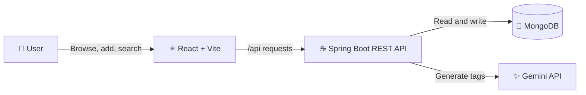
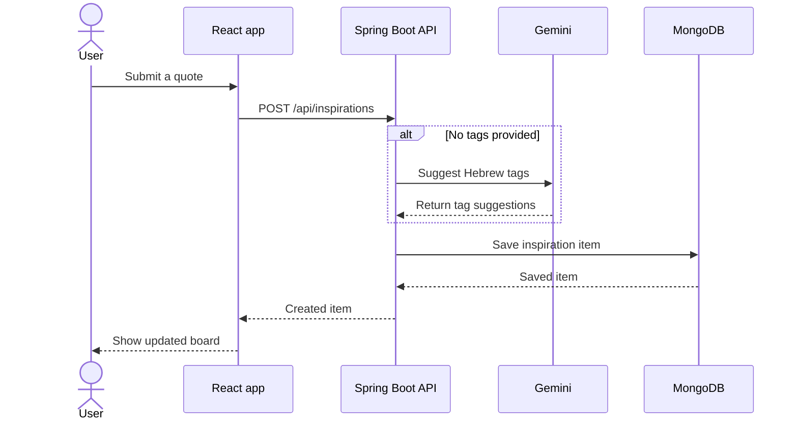

# ✨ InspireWall

### Your personal space for the words worth keeping.

Save quotes, thoughts, and small sparks of inspiration. Let AI suggest meaningful Hebrew tags, then browse your collection in a calm, searchable board.

**InspireWall** is a full-stack application built with **React**, **Java + Spring Boot**, **MongoDB**, and the **Gemini API**. It brings together a polished user experience and practical backend engineering in one evolving product.

> ✨ A thoughtful way to collect, organize, and rediscover the ideas that inspire you.

---

## 🌱 At a glance

| ✍️ Capture | 🏷️ Organize | 🔎 Rediscover |
| --- | --- | --- |
| Add quotes and thoughts with an optional author. | Generate Hebrew tags with Gemini when tags are not provided. | Search tags, choose suggestions, or click a tag on a card. |

| 🗃️ Persist | 🎨 Browse | 📴 Preview |
| --- | --- | --- |
| Store inspiration items in MongoDB. | Read in a responsive, card-based interface. | See sample items if the API is unavailable. |

## 🧰 Built with

| Layer | Tools | What they do |
| --- | --- | --- |
| **Frontend** | React, Vite, JavaScript, CSS | Renders the inspiration board and talks to the API. |
| **Backend** | Java 25, Spring Boot, Spring Web MVC | Exposes REST endpoints and applies application logic. |
| **Data** | Spring Data MongoDB, MongoDB | Stores inspiration items and their tags. |
| **AI** | Google Gemini API | Suggests short Hebrew tags for new items. |

## 🏗️ Architecture

The browser talks to the Spring Boot API. The backend persists items in MongoDB and calls Gemini when automatic tags are needed.



During local development, Vite proxies `/api` requests to `http://localhost:8080`. Gemini credentials stay in the backend environment; they are not sent to the browser.

### 🔄 Adding an inspiration



## 🚀 Run it locally

### Prerequisites

| Requirement | Used for |
| --- | --- |
| **Java 25** | Running the Spring Boot backend |
| **Node.js and npm** | Running the React + Vite frontend |
| **MongoDB** | Persisting inspiration items |
| **Gemini API key** | Generating tags for new items |

### 1. Start MongoDB

By default, the backend connects to:

```text
mongodb://localhost:27017/inspirewall
```

For another MongoDB instance, set `SPRING_DATA_MONGODB_URI` in the backend environment.

### 2. Start the backend

From the repository root, configure your Gemini API key and launch Spring Boot.

**macOS / Linux**

```bash
export GEMINI_API_KEY="your-gemini-api-key"
cd backend
./mvnw spring-boot:run
```

**Windows PowerShell**

```powershell
$env:GEMINI_API_KEY = "your-gemini-api-key"
cd backend
.\mvnw.cmd spring-boot:run
```

The API starts at **http://localhost:8080**. Keep API keys private—never commit them to the repository.

### 3. Start the frontend

Open a second terminal:

```bash
cd frontend
npm install
npm run dev
```

Open the local URL shown by Vite, usually **http://localhost:5173**.

## 🔌 REST API

**Base path:** `/api/inspirations`

| Method | Endpoint | Description |
| :---: | --- | --- |
| `GET` | `/api/inspirations` | List all inspiration items |
| `GET` | `/api/inspirations/{id}` | Get an item by ID |
| `POST` | `/api/inspirations` | Create an item; generate tags if none are provided |
| `PUT` | `/api/inspirations/{id}` | Update an item |
| `DELETE` | `/api/inspirations/{id}` | Delete an item |

**Create an item**

```bash
curl -X POST http://localhost:8080/api/inspirations \
  -H "Content-Type: application/json" \
  -d '{"content":"Small steps still move you forward.","author":"Anonymous"}'
```

## 🗂️ Project structure

```text
inspirewall/
├── backend/
│   └── src/main/java/com/inspirewall/backend/
│       ├── config/       # Gemini configuration
│       ├── controller/   # REST API
│       ├── exception/    # API exceptions
│       ├── model/        # MongoDB document
│       ├── repository/   # Spring Data repository
│       └── service/      # Business logic and AI tagging
├── frontend/
│   └── src/
│       ├── components/   # Board, cards, search, add-item dialog
│       ├── data/         # Sample inspirations
│       └── services/     # Backend API client
├── README.md
└── SPEC.md               # Product specification and roadmap
```

## 🧪 Run backend tests

From the repository root:

```bash
cd backend
./mvnw test
```

On Windows PowerShell, run `.\mvnw.cmd test`.

## 🛣️ What's next

The project roadmap focuses on growing both the product and the engineering foundations behind it:

| Phase | Focus |
| --- | --- |
| **01** | Strengthen the Spring Boot foundation: DTOs, validation, pagination, and tests |
| **02** | Make AI tagging more reliable and user-controllable |
| **03** | Explore semantic search with embeddings |
| **04** | Process AI tasks asynchronously |
| **05** | Add authentication and prepare for deployment |
| **06** | Generate optional AI backgrounds for inspiration cards |

These are **planned features**, not current capabilities. See [SPEC.md](./SPEC.md) for the detailed roadmap.

---

<p align="center">
  Made with ☕, curiosity, and a little AI ✨
</p>
